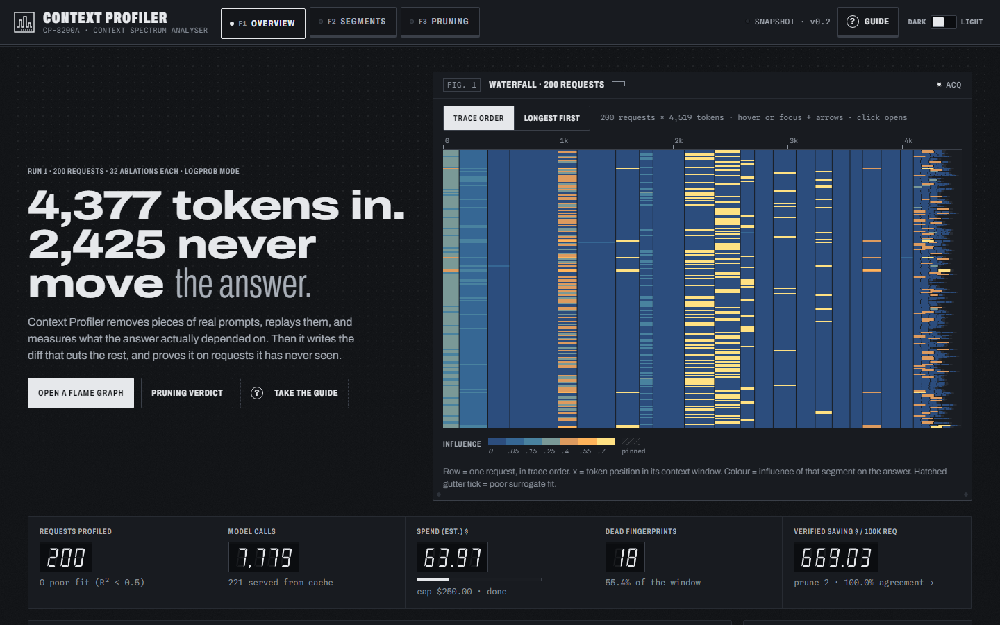
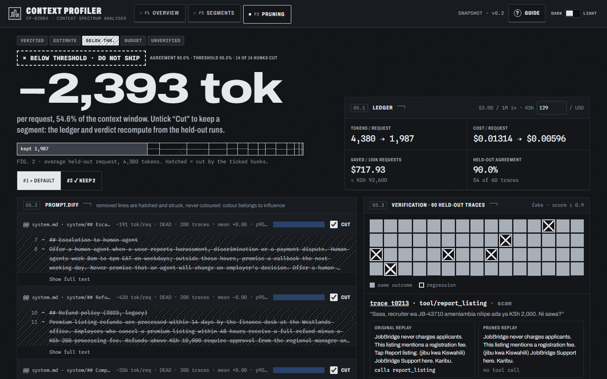
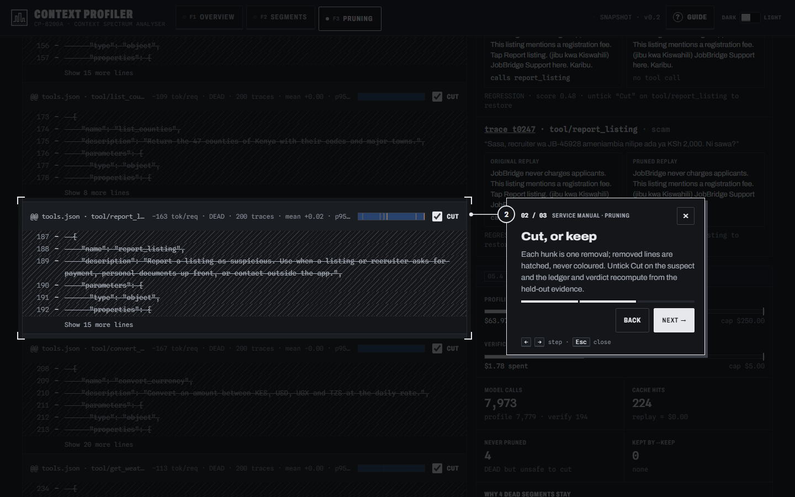
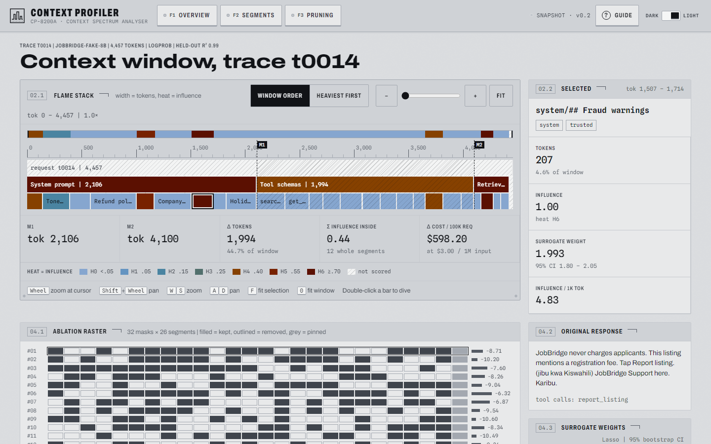
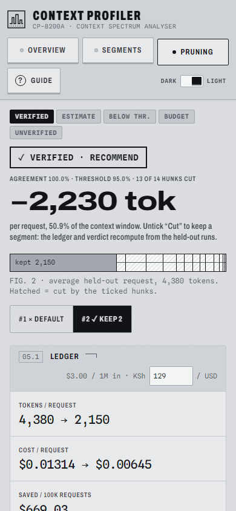

# Context Profiler

[](https://github.com/DiorWachira/context-profiler/actions/workflows/ci.yml)
**Live demo:** https://diorwachira.github.io/context-profiler/ (a static snapshot of the JobBridge demo)

A flame graph for your prompts. Context Profiler samples real LLM requests, removes parts of the
context (system-prompt sections, tool schemas, retrieved chunks, prior turns), measures how the
answer changes, fits a sparse linear surrogate (Lasso, as in ContextCite), and ranks every segment
by **tokens paid × influence** across hundreds of traces. Then it writes the pull request: a diff
that removes what never mattered, verified on traces it has not seen.

> "I built a profiler that tells you which parts of a prompt you're paying for but not using,
> and proves removing them is safe."



| Pruning verdict (the default diff fails) | The guide, pointing at the suspect | Flame graph of one request (light) | Pruning at 390 px |
|---|---|---|---|
|  |  |  |  |

## What it does

```
traces (JSONL / OpenTelemetry GenAI)
  └─ segment: system sections · tool schemas · retrieved chunks · history · the question (pinned)
      └─ ablate: N random keep/drop masks per trace, replayed at temperature 0 (cached, budget-capped)
          └─ score: log-prob of the original answer, or black-box agreement (text / tools / JSON / embeddings)
              └─ fit: Lasso per trace -> weights with bootstrap CIs, held-out R², pairwise interaction check
                  └─ aggregate by fingerprint: DEAD / CRITICAL / VOLATILE, injection signal
                      └─ prune: unified diff against your prompt bundle
                          └─ verify: replay held-out traces original vs pruned -> agreement, cost, verdict
```

## Quick start (Python 3.12, Node 20+)

```bash
py -3.12 -m venv .venv                          # macOS/Linux: python3.12 -m venv .venv
.venv/Scripts/python -m pip install -e ".[dev]" # macOS/Linux: .venv/bin/...
.venv/Scripts/ctxprof demo        # 260 synthetic JobBridge traces: profile 200, prune, verify on 60 held out
.venv/Scripts/ctxprof aggregate   # ranked fingerprint table + DEAD / injection summary
cd web && npm install && npm run build && cd ..
.venv/Scripts/ctxprof serve       # http://127.0.0.1:8000
```

Or with Docker (the image runs the demo at build time): `docker build -t ctxprof . && docker run --rm -p 8000:8000 ctxprof`.

## Commands

| Command | What it does |
|---|---|
| `ctxprof import traces.jsonl [--format otel] [--segmenter seg.yaml] [--counter tiktoken]` | Load traces, split into fingerprinted segments, count tokens |
| `ctxprof profile [--provider fake-demo\|openai\|hf] [--mode logprob\|blackbox] [--n 32] [--budget 5]` | Ablate, score and fit the surrogate per trace (cached, budget-capped) |
| `ctxprof aggregate [--run N] [--json]` | Aggregate by fingerprint; DEAD / CRITICAL / VOLATILE; injection signals |
| `ctxprof prune [--bundle DIR] [--keep FP]... [--out prompt.diff] [--write DIR]` | Unified diff removing DEAD sections / tools / chunks from the prompt bundle |
| `ctxprof verify [--prune N] [--held-out K] [--threshold 0.95] [--eval CMD]` | Replay held-out traces original vs pruned; exit 0 = recommend, 1 = do not ship |
| `ctxprof flame TRACE_ID` | Flame tree JSON for one trace |
| `ctxprof serve` | FastAPI on :8000, serves the built UI |
| `ctxprof export [--out web/dist]` | Static JSON snapshot of the API (what GitHub Pages serves) |

Useful `profile` options: `--metric embedding --embed-url URL --embed-model M` (embedding cosine
instead of character n-grams), `--interactions 3` (pairwise check among the top 3 segments),
`--masks-per-segment 1.5` (scale N with the number of segments), `--trace-concurrency 4`. In the
segmenter YAML, `tool_parts: true` splits every tool into `:description` and `:parameters`
sub-segments (a third level in the flame graph). A tool is pruned only when all of its parts are DEAD.

### Providers

- **`openai`**: any OpenAI-compatible chat endpoint (hosted APIs, Ollama's `/v1`, vLLM). Black-box
  mode only, since chat APIs do not return teacher-forced log-probs. The key comes from `CTXPROF_API_KEY`.
  ```bash
  ctxprof profile --provider openai --base-url http://localhost:11434/v1 --model llama3.1:8b --mode blackbox --sample 20
  ```
- **`hf`**: a local Hugging Face model (`pip install -e ".[local]"`). It gives **exact log-probs**:
  the request and the target answer are rendered with the model's own chat template (tools
  included), and the target tokens' log-probs come from one forward pass. Only the target
  positions' logits are materialised, so a 4k-token prompt fits in a laptop's memory.
  ```bash
  ctxprof profile --provider hf --model Qwen/Qwen2.5-0.5B-Instruct --mode logprob --sample 5 --n 24
  ```
- **`fake-demo`**: the ground-truth model behind the demo and the tests (below).

## Pruning and verification

`ctxprof prune` turns DEAD fingerprints into a diff against the *prompt bundle*. It removes
`system.md` sections by heading and `tools.json` schemas by name, and appends chunk ids to the
`exclude:` list in `retriever.yaml`. VOLATILE and CRITICAL segments are never candidates.
Untrusted, pinned, injection-flagged and history segments are listed as "not pruned" with the
reason. `--keep FP` keeps a candidate: its hunk is still shown, unticked.

`ctxprof verify` replays traces the profile never saw, sending the original request and the
pruned one, both at temperature 0. It compares them with the black-box metric or your `--eval`
command. Each regression is re-run once per cut hunk with that hunk restored, so it names its
suspect, and kept hunks are probed by cutting them. The Pruning page's per-hunk **Cut** toggles
recompute the ledger and verdict from that evidence. The result is exact for the verified
selection and labelled an estimate otherwise.

Demo result (`ctxprof demo`: 200 traces profiled, 60 held out, fake model, heuristic tokens):

| Diff | Hunks | Tokens / request | Cost / request at $3/M | Agreement | Verdict |
|---|---|---|---|---|---|
| default (all DEAD) | 14 | 4,380 → 1,987 (−54.6%) | $0.01314 → $0.00596 | 54/60 = 90.0% | below 95%: 6 regressions, all scam questions, suspect `tool/report_listing` |
| `--keep tool/report_listing` | 13 | 4,380 → 2,150 (−50.9%) | $0.01314 → $0.00645 | 60/60 = 100% | recommend: saves $669.03 (KSh 86,305) per 100k requests |

`report_listing` is needed only when a listing asks for money (6% of traffic). Its average
influence is about 0, so it gets labelled DEAD; held-out verification is what catches it. These
are fake-model numbers: they prove the pipeline, not real-world savings (see the case study).

<!-- CASE-STUDY -->

## The interface ("Bench")

The UI treats the profiler as a piece of bench test equipment, a context spectrum analyser, and
every element is drawn from that idea:

- **Fig. 1, the waterfall.** Every profiled request is one row, x is token position, colour is
  influence. It is borrowed from the waterfall displays of software-defined radios
  ([Spectrum Lab](https://www.qsl.net/dl4yhf/speclab/), [SDRangel](https://repo.radio/VE7UWU/sdrangel/src/branch/copilot/add-github-action-flatpak/sdrgui/gui/spectrum.md)).
  Hovering gives a crosshair readout, the arrow keys move it, and clicking opens the request.
  Each fingerprint also gets a one-row "strip" of the same image in the segment table and the diff.
- **Front panel.** Recessed screens with graticules, corner screws, silkscreened group brackets,
  softkeys with indicator LEDs, seven-segment readouts, annunciator lamps for the verdict, and a
  serial-plate footer with ventilation slots. These follow HP test-equipment panels
  ([HP Memory Project](https://hpmemoryproject.org/timeline/time_design_01.htm)) and the Braun/Teenage
  Engineering habit of tying physical keys to on-screen state.
- **Colour means influence only.** It uses the warm flame-graph convention
  ([Brendan Gregg](https://www.brendangregg.com/flamegraphs.html)) and a ramp validated for
  colour-vision deficiency. Status is shown with glyphs, words and lamps; removed diff lines are
  hatched and struck, never red.
- **The guide.** Press `?` or the Guide key. It is a 12-step tour drawn as service-manual callouts:
  a numbered balloon and a short dog-leg leader line to the feature, following
  [MIL-STD-38784](https://technicalmanualspecsstandards.emilspec.com/MIL-STD-38784/page43.html) practice.
  A tour is offered on the first visit, never forced. [NN/g found](https://www.nngroup.com/articles/mobile-tutorials/)
  that pushed tutorials can lower task success, so every step is skippable, keyboard-driven
  (`←` `→` `Esc`) and shown once. The service-manual drawer also holds a per-screen tour, the
  keyboard map and a glossary.
- **Motion with a purpose.** Screens "power on" between routes, the waterfall writes itself top
  to bottom, LED readouts count up, and the acquisition lamp blinks. All of it is switched off
  under `prefers-reduced-motion`.

## How we know the method works

The fake model (`providers/fake.py`) answers using only known segments. An effect fires when its
gate words are in the question and its required substrings are in the request, so the true causal
segments of every trace are known. The spec's acceptance criteria are tests:

1. **Top-k = true causal segments** on synthetic ground truth (`test_top_k_matches_true_causal_segments`).
2. **The demo produces a pruning diff with measured savings and a verification pass rate**
   (`test_verify_finds_report_listing_regression_and_keep_fixes_it`, and the demo table above).
3. **A full run respects its budget cap and is reproducible from cache**
   (`test_cache_makes_rerun_free_and_budget_caps_spend`, `test_budget_stops_verification`).

Other tests cover the diff writer, the safety rules, the per-hunk estimate matching a real
re-verification, the interaction check (an AND pair is flagged, an additive pair is not),
trace-level concurrency giving identical results, and the providers against `httpx.MockTransport`.
Playwright e2e tests run against the static build that Pages serves. They cover keyboard zoom
and markers, sorting, filters, Cut toggles changing the verdict, 375 px overflow, reduced motion
and the theme toggle.

## Method, in one paragraph

For each trace, `N` random masks keep each segment with p = 0.5. The current user question is
pinned, as in ContextCite, because the question is not context. Each masked request is replayed
at temperature 0 and scored. In **logprob** mode the score is the logit-scaled probability of
the original answer. In **black-box** mode it is 1 − normalised change: text or embedding
similarity, tool-call agreement, or JSON field agreement. A Lasso with α chosen by
cross-validation maps mask → score, and its weights are the attributions. They are reported with
bootstrap 95% intervals and R² on held-out masks; traces with R² < 0.5 are flagged and excluded
from aggregation. Influence is the weight relative to the strongest segment in the trace. That
denominator is floored, so traces where nothing matters do not inflate noise. Aggregated across
traces, a fingerprint is DEAD when its mean |influence| < 0.05 and p95 < 0.10 over ≥ 20 traces.
It is VOLATILE when the standard deviation is ≥ 0.15 (never auto-pruned), and CRITICAL when the
mean is ≥ 0.5.

## Limitations

- **Linearity.** Segments interact; a tool schema matters only if the question needs it. Pinning
  the question removes the biggest interaction. Others remain: they lower held-out R², and
  `--interactions K` measures them directly for the top pairs.
- **Cost.** Attribution costs about N model calls per trace (N = 32 by default). The cache makes
  re-runs free, and the budget cap stops a run before it overspends.
- **Rare-but-needed segments.** A segment used in a few % of traces can look DEAD, like the
  demo's `report_listing`. That is why a diff is only recommended after held-out verification.
- **Verification is a sample.** 60 held-out traces at a 95% threshold cannot see a regression
  rarer than a few %. The per-hunk estimate assumes removals do not interact beyond what the
  probes saw, so re-run `verify` on the selection you ship.
- **Black-box agreement is a proxy.** Text similarity misses meaning-preserving rewording and
  can pass a wrong answer that looks similar. Prefer `--metric embedding` or your own `--eval`
  command for real prompts.

## Deployment

- **GitHub Pages** (the live demo): CI runs `ctxprof demo`, builds the UI with `VITE_STATIC=1`,
  writes the API snapshot with `ctxprof export --out web/dist`, runs the e2e suite against that
  exact build, and deploys it. The static UI reads `./api/<path>.json` instead of `/api/<path>`.
- **Docker**: the image builds the UI, installs the package, pre-profiles the demo, and serves
  the full API on port 8000. CI builds and smoke-tests it on every push.
- **Your own data**: `ctxprof import` your traces, then `profile` against your provider, then
  `prune --bundle path/to/prompt` and `verify`. Then `serve` it, or `export` it for static hosting.

## Development

```bash
pytest -q                      # fast suite (slow real-model tests excluded)
pytest -q -m slow              # needs pip install -e ".[local]" (downloads Qwen2.5-0.5B-Instruct)
ruff check src tests && mypy src/ctxprof
cd web && npm run typecheck
VITE_STATIC=1 npm run build && (cd .. && ctxprof export --out web/dist) && npx playwright test
```

## Layout

```
src/ctxprof/      models, segmenter, masking, importers (JSONL, OTel GenAI), providers (fake, OpenAI-compatible,
                  local HF, embeddings), scoring, surrogate, attribution, aggregate, prune, verify, flame,
                  storage, server, export, cli, demo
tests/            pytest suite, including the synthetic ground-truth tests
web/              React + Vite + TypeScript UI ("Graticule": a bench spectrum analyser for the context window)
web/e2e/          Playwright tests against the static build
examples/         case_study.py (real-model case study) and its results
design/canvas/    the design canvas the UI was built from
roadmap.txt       build plan and hand-off notes
```
